# CSE360 Project – Pomodoro Bot

An **Arduino Uno desk companion robot** that helps students and office workers stay productive. It runs Pomodoro focus/break sessions and warns when you sit too close to the screen. It also monitors temperature, humidity and noise, controls a desk light automatically, reminds you to drink water, and pauses when you walk away. All of this is controlled with touch gestures on one sensor, with spoken audio alerts.

**Course:** CSE360 – Computer Interfacing, BRAC University (Spring 2026)

**Team (Group 03, Section 06):** Omar Faruk, Raiat Reza, MD. Abir Hasan Piash, Tanzim Ahmmed

<p align="center">
  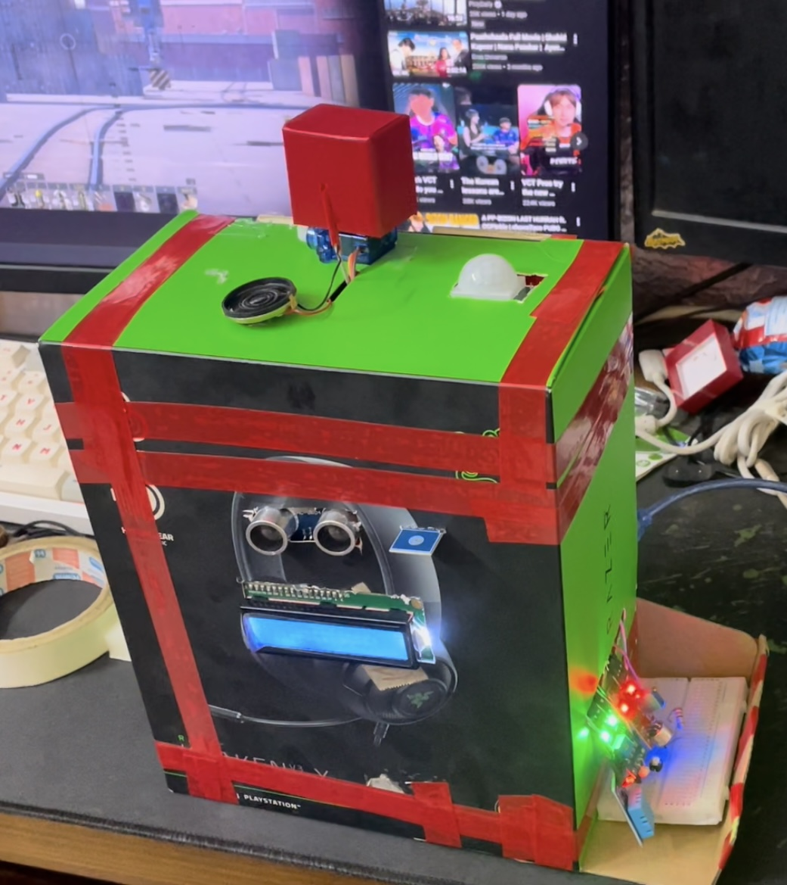
</p>

## Features

| Feature | How it works |
|---|---|
| **Pomodoro timer** | Three modes: **M1** 25 min focus / 5 min break, **M2** 50 / 10, **M3** 15 / 3. It switches between focus and break automatically and counts sessions. |
| **Servo "head"** | Shows the current state by its angle: focus 90°, normal 70°, sleep 30°, break 10°. |
| **Posture warning** | The HC-SR04 checks distance every 300 ms. Closer than 30 cm shows **"Too Close!"** and plays a voice alert, limited to once every 5 s. |
| **Noise monitor** | The microphone level is sampled every 100 ms. Above the threshold, it shows **"Too Much Noise!"** with the reading. |
| **Climate monitor** | DHT11 temperature and humidity on the home screen. Humidity is classed as *Too Dry* (< 30%), *Normal* or *Too Humid* (> 70%). |
| **Smart desk light** | *Auto:* LED brightness follows the LDR reading. *Manual:* three brightness levels. |
| **Away detection** | Outside Pomodoro sessions, with no PIR motion for 30 s, it asks **"Are you away?"** and pauses. When motion returns, it resumes with **"Welcome Back"**. |
| **Hydration reminder** | Shows **"Drink Water"** and plays a reminder every hour. |
| **Sleep mode** | After 10 s paused, the screen clears and the head moves to the sleep position. |
| **Real-time clock** | The DS3231 shows the time on the home screen and resets the session count at midnight. |
| **Voice feedback** | A DFPlayer Mini plays MP3 clips for startup, beep, warning, welcome back and hydration. |
| **Reset button** | Shows "System Resetting..." and restarts the program. |

### Touch gestures (TTP223)

| Gesture | Action |
|---|---|
| Single tap | Start / stop a Pomodoro session, or pause / resume in normal mode |
| Double tap | Switch the light between auto and manual |
| Triple tap | Cycle manual brightness (off → low → high) |
| 4 taps | Show humidity and its classification |
| Long press (> 1.2 s, while paused) | Cycle mode: Normal → M1 → M2 → M3 |

## Hardware

| Component | Purpose |
|---|---|
| Arduino Uno R3 | Main controller |
| HC-SR501 PIR sensor | Presence / motion detection |
| HC-SR04 ultrasonic sensor | Distance for the posture warning |
| DHT11 | Temperature and humidity |
| LDR light sensor module | Ambient light level |
| High-sensitivity microphone module | Noise level |
| TTP223 capacitive touch sensor | Gesture input |
| Push button | System reset |
| 16x2 LCD with I2C backpack | Display |
| DS3231 RTC module | Real-time clock |
| SG90 servo motor | Robot head |
| DFPlayer Mini + 28 mm speaker | Voice alerts |
| LED | Desk light (represents a lamp) |
| 220 Ω and 1 kΩ resistors | Current limiting |

**Total cost: BDT 2,906.98.** The full breakdown is in the [report](Project_Report.pdf). The body is a recycled cardboard box, and the bot runs from a 5 V power bank.

### Pin mapping

| Arduino pin | Connected to |
|---|---|
| D2 | TTP223 touch sensor |
| D3 | DHT11 data |
| D4 | PIR sensor output |
| D5 (PWM) | Desk-light LED |
| D6 | Reset push button (`INPUT_PULLUP`) |
| D8 | Servo signal |
| D9 / D10 | HC-SR04 TRIG / ECHO |
| D11 / D12 | DFPlayer Mini, SoftwareSerial (Arduino RX / TX) |
| A0 | Microphone (analog) |
| A1 | LDR (analog) |
| A4 / A5 (SDA / SCL) | LCD (I2C address `0x27`) and DS3231 RTC, on a shared I2C bus |

**Protocols:** the LCD and RTC share the **I2C** bus, and the DFPlayer Mini uses **UART** through SoftwareSerial at 9600 baud.

## Design

| System architecture | Circuit schematic (Fritzing) |
|---|---|
| 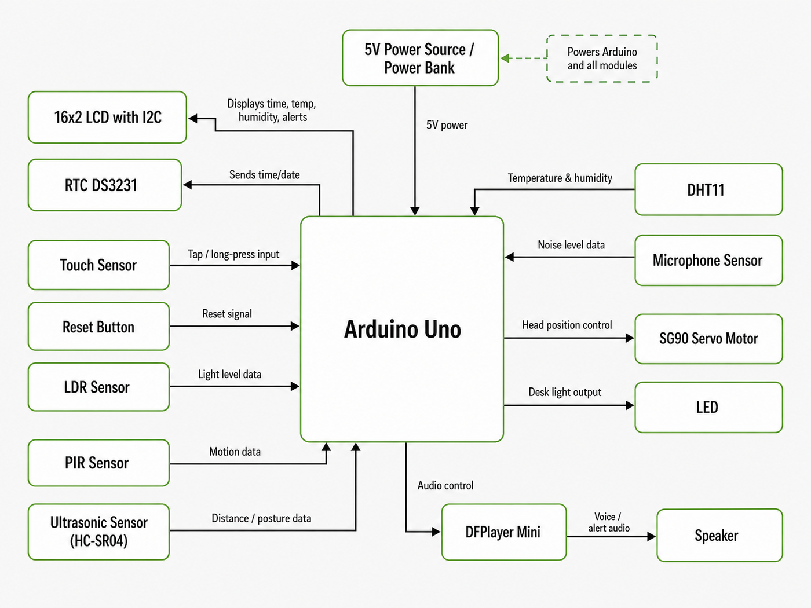 | 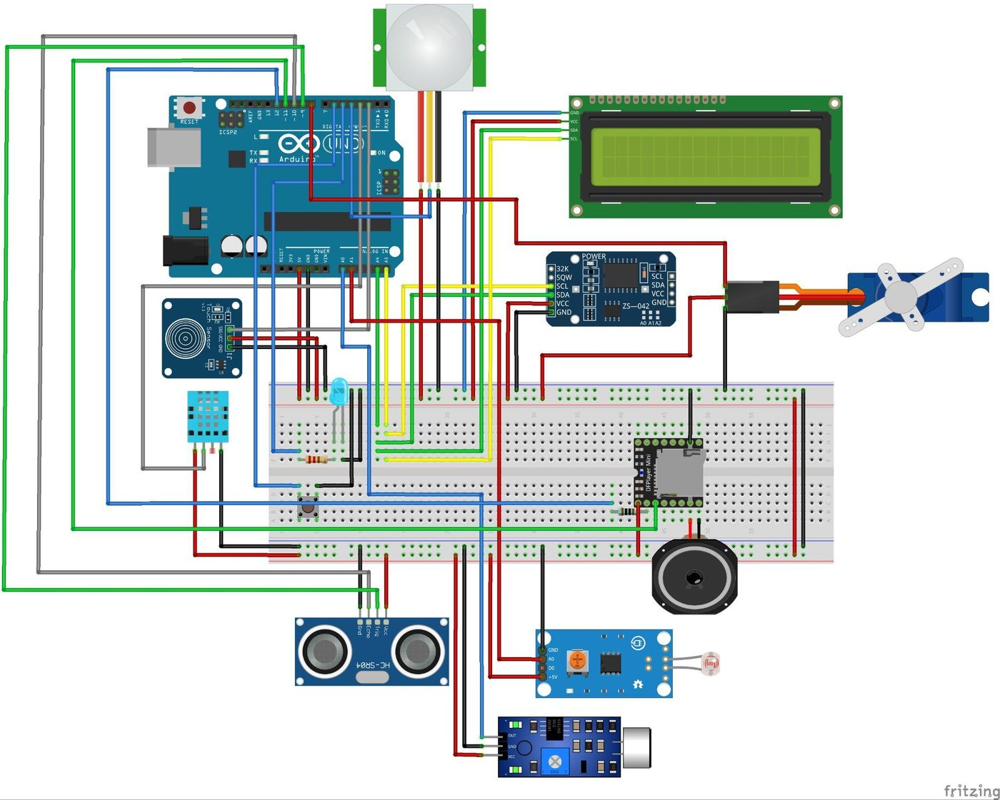 |

| Flowchart | Prototype wiring |
|---|---|
| 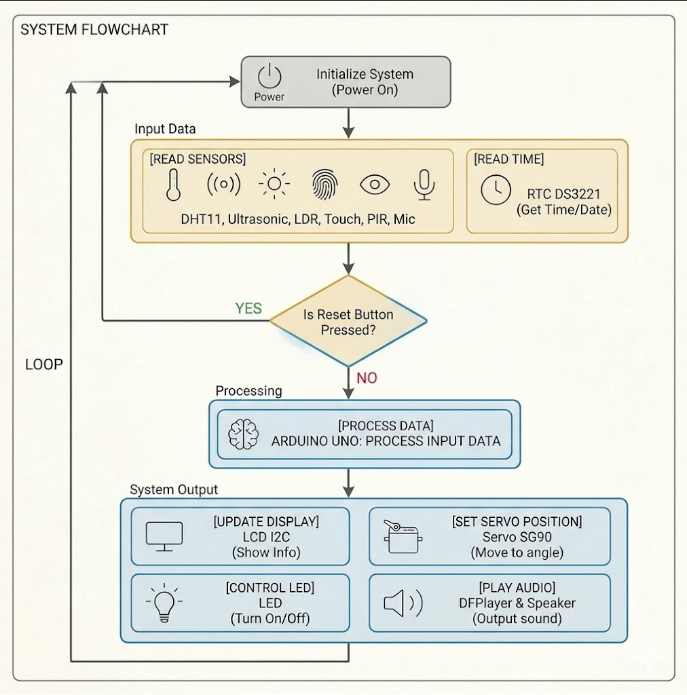 | 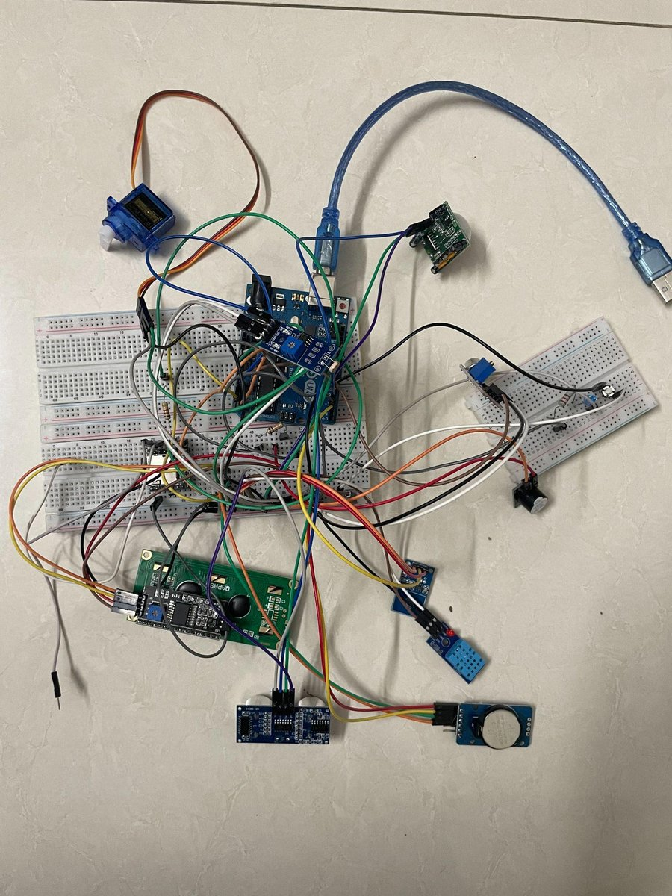 |

## Results

| | |
|---|---|
| 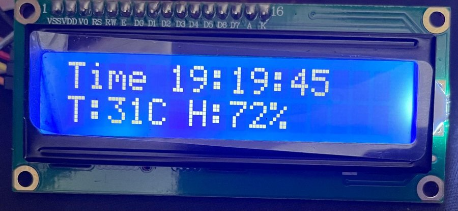<br><sub>Home screen: time, temperature, humidity</sub> | 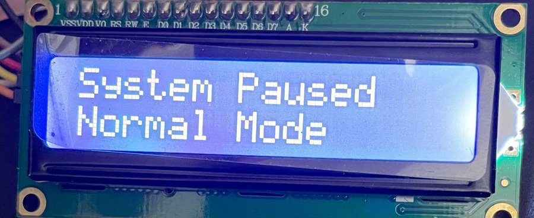<br><sub>Single tap: system paused</sub> |
| 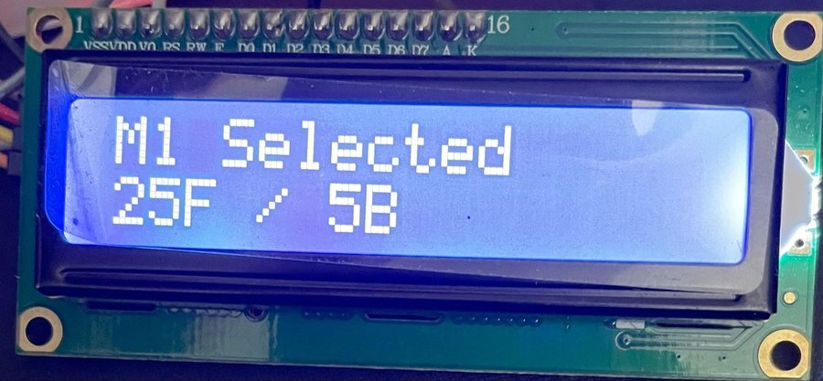<br><sub>Long press: Pomodoro mode M1 selected</sub> | 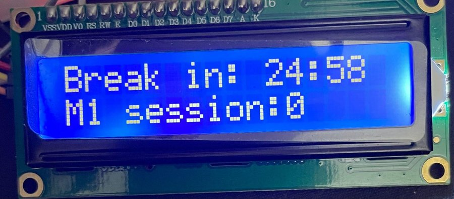<br><sub>Single tap: M1 focus session running</sub> |
| 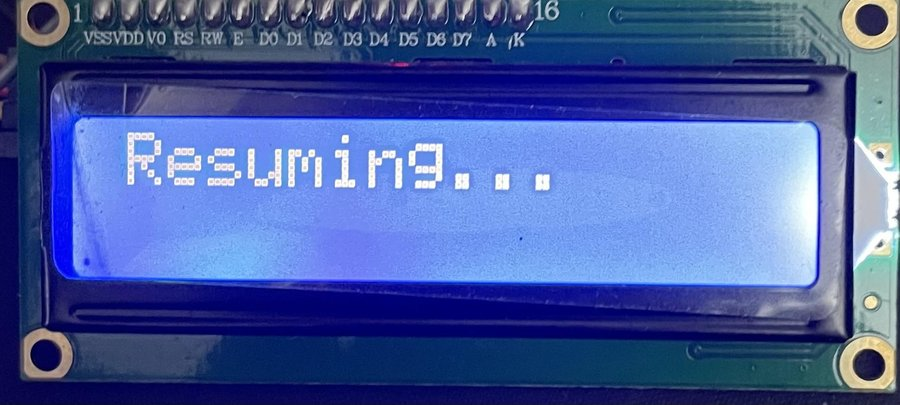<br><sub>Resuming normal mode</sub> | 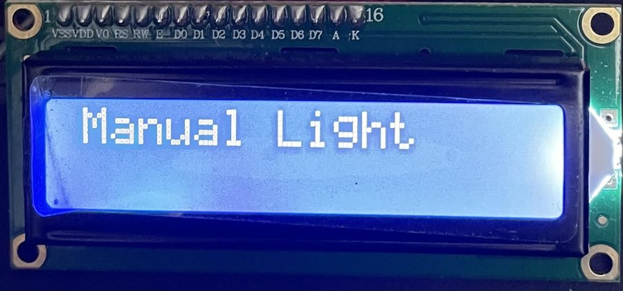<br><sub>Double tap: manual light control</sub> |
| 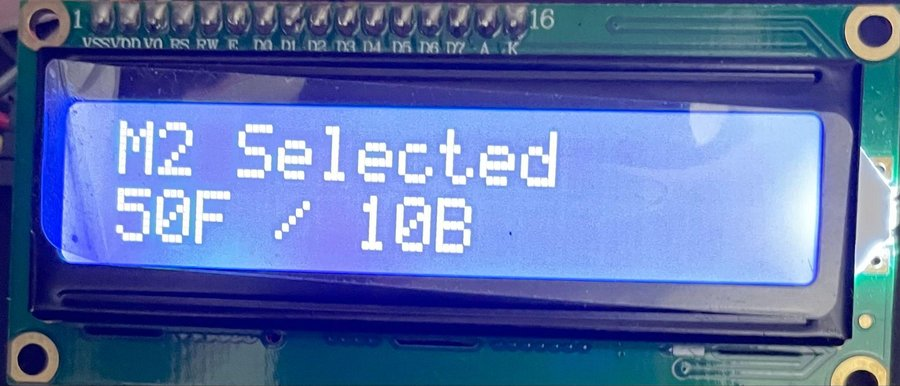<br><sub>Switched from M1 to M2</sub> | |

## How to run

1. Install the **Arduino IDE** (2.x).
2. Install these libraries from *Library Manager*:
   - `LiquidCrystal I2C` (the Frank de Brabander version, which provides `lcd.begin()`)
   - `SimpleDHT`
   - `RTClib` (Adafruit)
   - `DFRobotDFPlayerMini`
   - `Servo` and `SoftwareSerial` come with the IDE.
3. Copy the audio clips onto a microSD card (FAT32) in a folder named `mp3`, then insert it into the DFPlayer:

   | File | Clip |
   |---|---|
   | `/mp3/0001.mp3` | Beep |
   | `/mp3/0002.mp3` | "Too close" warning |
   | `/mp3/0003.mp3` | Startup tune |
   | `/mp3/0004.mp3` | Welcome back |
   | `/mp3/0005.mp3` | Drink water reminder |

4. Wire the parts using the pin table above.
5. Open `pomodoro_bot/pomodoro_bot.ino`, select **Arduino Uno**, and upload.

Thresholds such as `noiseThreshold`, the 30 cm posture distance and the timer lengths are constants at the top of the sketch. Adjust them to suit your room and sensors.

## Challenges

- Powering the Arduino and the servo from one supply was unreliable, so other power sources had to be tried.
- The Arduino can't decode audio, so a separate DFPlayer Mini module was needed.
- Libraries for some of the sensors were hard to find.

## Future work

- Daily focus counter and daily goal system.
- A relay module to drive a real desk lamp instead of an LED.
- A head that turns to follow detected motion.
- A DHT22 for more accurate climate readings.

## Contributions

| Member | Work |
|---|---|
| **Omar Faruk** | PIR motion sensor, 16x2 I2C LCD and LDR light sensor (wiring and pin assignment). Created the circuit schematic in Fritzing. |
| Raiat Reza | DHT11, touch sensor and HC-SR04 ultrasonic sensor. Created the flowchart. |
| MD. Abir Hasan Piash | DS3231 RTC, DFPlayer Mini and speaker. |
| Tanzim Ahmmed | Microphone sensor and SG90 servo. IDE setup and the workflow diagram. |

## Repository structure

```
├── pomodoro_bot/
│   └── pomodoro_bot.ino   # Arduino sketch
├── images/                # Robot photo, diagrams and LCD result photos
└── Project_Report.pdf     # Full project report
```

## Inspiration

Based on Clinton Emerhana's *How to Make a Pomodoro Study Clock Using Arduino* (Medium, 2025), extended with sensing, lighting, audio and posture features.
